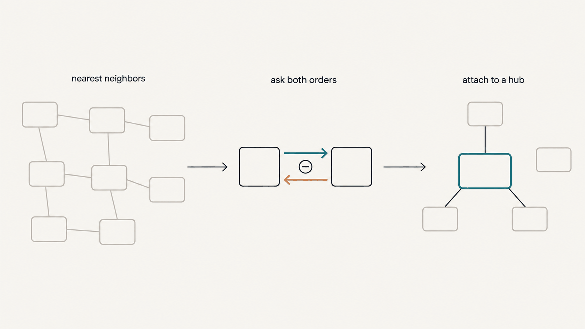
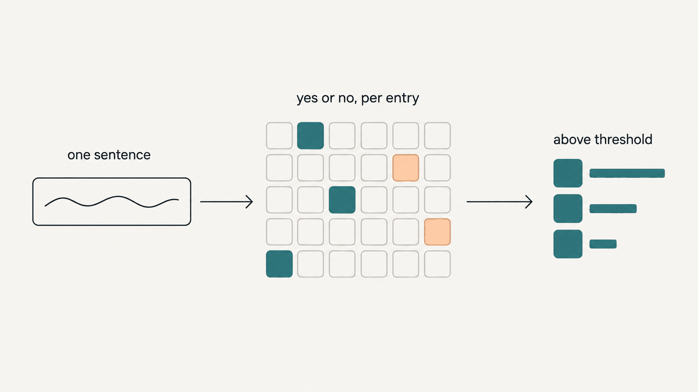

[English](README.md) | **한국어**

# jev-judge-rank


**Jev(TypeSafe System One)로 목록을 여러 기준에 따라 채점해 순위를 매기고, 거의 같은 항목을 묶고, 상황 한 문장에 쓸모 있는 항목만 불러온다.**

Jev는 판정 모델이라 글을 쓰지 못한다. JSON 상태를 주고 질문하면 세 가지 꼴로 답한다. Choice(보기 중 하나 고르기), Score(말로 적어 둔 등급 중 어디인가), Noul(문장이 참일 확률). 답은 글이 아니라 확률과 확신도다. 요청 하나는 0.5초 안팎이고(아래 예제 실행의 중앙값은 0.29초) 입력 100만 토큰당 0.042달러, 출력은 무료다. 그래서 긴 목록의 항목마다 같은 좁은 질문을 던져도 부담이 없다. LLM 프롬프트 한 번에 "좋은 것 골라 줘"를 맡기면 근거가 흐리고 결과를 다시 만들기 어려운데, 이 저장소는 그 일을 스크립트 셋으로 나눠 한다.

- `scripts/jev_rank.py`: 항목마다 여러 축으로 판정하고 가중 종합 점수로 정렬한다.
- `scripts/jev_dedupe.py`: 거의 같은 항목을 찾아 대표 항목 하나 밑으로 묶는다.
- `scripts/jev_recall.py`: 상황을 적은 문장 하나를 받아 말뭉치에서 그 상황에 도움이 될 항목을 돌려준다.

Python 3.9 이상, 표준 라이브러리만 쓴다. 요청과 응답은 전부 로컬 로그(`raw_jev.jsonl`)에 남는다.

아래는 기록해 둔 예제 실행(가상의 아이디어 카드 40장, 요청 80회)에서 나온 보고서의 앞부분이다.

```
Jev rank (2026-10-07)

...
Scale: items 40 · judged 40 · missing 0 · Jev calls 80 · input 42,526 tokens ≈ $0.002
Checks: feasibility vs has_demo rank correlation 0.265 (n=40)
...
==============================================================================
Part 1. Top 10 overall
==============================================================================

#1 [I36] Code Change Risk Triage   strengths [usefulness·feasibility]
  scores: novelty 1.73/4 · usefulness 2.97/4 · feasibility 3.62/4 · combined 0.67 · pitch_mechanism 0.88
  pitch: Sorts incoming pull requests by how risky they are so the riskiest get reviewed first.

#2 [I32] Dataset License Checker
  scores: novelty 1.90/4 · usefulness 2.70/4 · feasibility 3.25/4 · combined 0.637 · pitch_mechanism 0.6
  pitch: Checks whether a dataset's license allows the use you plan before you download it.

#3 [I12] Pull Request Risk Labeler   strengths [usefulness]
  scores: novelty 1.68/4 · usefulness 2.98/4 · feasibility 3.15/4 · combined 0.636 · pitch_mechanism 0.75
  pitch: Labels each pull request low, medium or high risk so reviewers know where to look first.
```

전체 파일은 `examples/ideas/out/`에 있다. 목록의 반대쪽 끝에서는 막연한 아이디어 여섯 개("An AI assistant that makes your workday easier.")가 참신성 0.00~0.07, "피치가 메커니즘을 말한다"는 확률 0.06~0.13을 받아 35~40위에 놓였다.

## 지키는 규칙 다섯, 그리고 그 근거가 된 숫자

1. **항목 하나에 요청 하나.** 한국어 댓글 10개를 한 요청에 넣고 번호로 물었더니 8개만 맞았다. 틀린 두 개를 따로 물으니 둘 다 맞았다(확신도 0.92, 0.99). 표본은 작지만 따로 묻는 데 드는 추가 비용이 거의 없어서, 세 스크립트 모두 항목(또는 쌍) 하나에 요청 하나를 보낸다. 질문은 다르게 다룬다. 같은 상태에 대한 질문 여러 개는 한 요청에 넣는다. 병렬로 답하므로 시간이 거의 늘지 않는다.
2. **쌍은 순서를 바꿔 두 번 묻는다.** 공개 한국어 벤치마크(mahlernim/jev-korean-benchmark)에서 입력 순서만 바꿨는데 답의 13%가 바뀌었다. 같은 요청을 다시 보냈을 때는 1~2%였다. `jev_dedupe.py`는 모든 쌍을 (a, b)와 (b, a)로 물어 평균을 낸다. 아래 예제 실행에서도 한 쌍은 두 순서의 답이 0.11 차이 났다(0.95와 0.84).
3. **중복은 대표에 붙이고, union-find로 잇지 않는다.** union-find는 A~B, B~C이면 A와 C가 서로 다른 것이어도 한 묶음으로 만든다. 실제로 이런 전이 병합 때문에 보안 벤치마크 하나가 상관없는 프로젝트의 묶음에 들어간 적이 있다. 여기서는 항목마다 지금까지 정해진 대표하고만 비교한다. 프로젝트 카드 254장에서 나온 3,280쌍을 재 보니 진짜 중복도 대부분 0.65~0.77이었고 0.85에 닿은 쌍은 없었다. 기본 문턱 0.65는 여기서 나왔다.
4. **상태에 없는 사실을 Jev에 묻지 않는다.** README를 상태에 넣지 않은 채 "이 카드가 README에 근거했나"를 물었더니 답의 65%가 0.3~0.7("모르겠다")에 몰렸고, 그 감점이 상위 100의 순위 8자리를 바꿨다. 문서 본문 대신 파일 이름과 경로만 줬을 때는 50개 중 47개가 0.3~0.85에 몰렸다. "데모가 있나" 같은 사실은 항목 필드에 두고, `jev_rank.py`가 결정론적인 `field_penalties` 감점으로 처리한다.
5. **고르기를 넓은 Choice에 맡기지 않는다.** 사회 추리 게임의 투표 119표(한 진영의 표)를 다시 돌려 보니, 전체 플레이어 중 하나를 고르는 Choice 한 번은 33~38%로 무작위 선택(51%)보다 낮았다. 후보마다 좁은 Noul을 묻고 코드가 더해 문턱을 적용하니 71~79%였다. 여기서 "넓다"는 보기가 11개 이상이라는 뜻이다. 보기가 7개 이하일 때는 작은 시험에서 순서를 바꿔 두 번 묻는 Choice가 보기마다 Noul을 묻는 쪽보다 나았다(8개 중 5개 대 3개). 순위를 매길 때는 항목마다 Score를 묻고 정렬은 코드가 한다.

Noul 답 0.5는 "중간"이 아니라 "모르겠다"다. 정도를 재려면 Score를 쓴다. Score 답은 등급 번호의 기댓값이라 5단계면 0~4다(1~5가 아니다). `jev_rank.py`는 이 값을 최고 번호로 나눠 쓴다.

## 설치

Python 3.9 이상. 표준 라이브러리만 쓰므로 `pip install`할 것이 없다.

1. 이 저장소를 클론하거나 내려받는다. Claude Code 스킬로도 쓰려면 폴더를 `~/.claude/skills/jev-judge-rank`에 둔다. 스크립트가 `scripts/` 아래에 있어서 그 자리에서 그대로 동작한다.
2. https://console.typesafe.ai/settings/keys 에서 API 키를 만들고 환경변수로 내보낸다.

```bash
export TYPESAFE_API_KEY=...
```

스크립트는 이 환경변수에서만 키를 읽는다. `--help`와 `jev_dedupe.py --dry`는 키 없이도 돈다.

## 빠른 시작

저장소 최상위에서 실행한다. 아래 명령은 git이 무시하는 `./out/`에 결과를 쓴다. `examples/*/out/`에는 이 README를 위해 기록한 실행 결과(2026-10-07, `jev-latest`가 `jev-1.13.0`으로 답함)가 들어 있다. 같은 명령에서 `--out`만 `examples/` 안으로 바꿔 만든 것이다.

### 순위 (rank)


```bash
python3 scripts/jev_rank.py --items examples/ideas/items.json --config examples/ideas/axes.json \
  --out out/rank --check feasibility:has_demo
```

`examples/ideas/items.json`에는 가상의 아이디어 카드 40장(`id`, `name`, `pitch`, `mechanism`, `has_demo`)이 있다. `examples/ideas/axes.json`은 항목마다 요청을 두 번 보낸다. 하나는 Score 축 셋(참신성, 쓸모, 실현 가능성. 가중치 1, 1, 0.7)을 묻고, 다른 하나는 상태에 피치만 넣고 감점용 Noul "피치가 구체적인 메커니즘을 말한다"를 묻는다. `has_demo`는 보내지 않고 0.05짜리 필드 감점으로만 쓴다. 기록한 실행: 요청 80회, 입력 42,526 토큰, 0.0018달러, 종료 코드 0.

- 여기서는 40장 전부에 순위를 매겼기 때문에 1위(I36)와 3위(I12)가 말만 바꾼 같은 아이디어다. 실제 목록이라면 dedupe를 먼저 돌리고 대표만 순위를 매긴다.
- `--check feasibility:has_demo`는 축 하나와 숫자 필드 사이의 스피어만 순위상관을 보고서에 적는다. 결과는 0.265(n = 40)로, 예상한 방향으로 약하게 맞는다. 방향을 보는 점검이지 정확도를 재는 것이 아니다. 0.4 아래를 경고로 읽는 것은 두 쪽이 같은 것을 잴 때뿐이다.
- 설정을 새로 짰으면 먼저 짧게 돌려 본다. `--limit 10`을 붙여 축마다 점수가 고루 퍼지는지 보고, 전부 한 등급에 몰리면 등급 문장을 고친다. 그다음 `--limit` 없이 같은 `--out`으로 돌리면 이미 판정한 항목은 다시 묻지 않는다.

### 중복 묶기 (dedupe)



```bash
python3 scripts/jev_dedupe.py --items examples/ideas/items.json --text-fields pitch,mechanism \
  --order-field has_demo --out out/dedupe
```

가능한 쌍 780개 중 TF-IDF가 후보 8쌍만 남겼고, 쌍마다 두 번 물었다. 요청 16회, 0.0003달러. 일부러 넣어 둔 중복 5쌍은 평균 0.895~0.975로 전부 묶였고, 나머지 후보 3쌍은 0.03~0.055였다. 일부러 넣은 중복은 문장만 바꾼 것이라 실제 목록의 중복(0.65~0.77, 규칙 3)보다 점수가 높게 나온다. 결과는 대표 35개, 대표 밑으로 묶인 항목 5개이고 `examples/ideas/out/dedupe/groups.json`에 있다.

`--dry`를 붙이면 키도 요청도 없이 후보 쌍 수만 센다. 다른 옵션: `--against old.json`은 예전 목록과도 비교해 같은 것을 `dup_against`에 적는다. `--component-field`와 `--component-values`는 부품(SDK, MCP 서버, 플러그인, 목록)이 낀 쌍에 더 엄격한 질문을 쓴다. 기본 질문의 "언어만 다르면 참" 조항 때문에 Go SDK와 MCP 서버를 같은 것으로 묶은 적이 있어서다. `--sim-fields`는 Jev에 보내지 않고 이웃 찾기에만 쓸 필드를 더한다. 나머지는 `python3 scripts/jev_dedupe.py --help`에 있다.

### 불러오기 (recall)



```bash
python3 scripts/jev_recall.py --corpus examples/recall/corpus.json \
  --query "a Stop hook that checks whether the agent's done claim is backed by evidence" --out out/recall
```

예제 말뭉치는 공개된 Jev 프로젝트들에서 모은 Jev 설계 패턴 35개를 한 줄씩 요약한 것이다. kind가 `family`라서 35개를 전부 판정한다. 요청 35회, 0.0006달러. 문턱 0.5를 넘은 것은 넷이다.

```
0.76 [F02] Completion-claim check at stop -> stingray
0.62 [F27] Supervisor alongside a coding agent -> hermes-jev
0.62 [F17] Extraction by pointing at numbered fragments -> jeveryword
0.54 [F08] Memory selection, recall and validation -> jevmory
```

질의에는 내려야 할 판정, 즉 무엇을 무엇으로 가를지를 적는다. 넘은 것이 없으면 질의를 고쳐 쓰거나 `--threshold`를 낮춘다.

## axes.json 설정

최상위:

| 키 | 형식 | 기본값 | 뜻 |
|---|---|---|---|
| `requests` | 목록 | 필수 | 항목마다 보낼 요청들(아래) |
| `id_field` | 문자열 | `"id"` | 항목의 고유 id |
| `title_field` | 문자열 | `"name"` | 보고서에 보일 제목 |
| `state_fields` | 문자열 목록 | id를 뺀 모든 필드 | Jev에 보낼 항목 필드. 요청마다 따로 정할 수 있다 |
| `field_penalties` | 객체 목록 | `[]` | `{"field": ..., "below": ..., "penalty": 0.10}`: 숫자 필드가 `below`보다 작으면 `penalty`를 뺀다. 필드가 없거나 숫자가 아닌 항목은 감점하지 않는다 |
| `tie_break_field` | 문자열 | 없음 | 숫자 필드. 종합 점수가 같으면 값이 큰 쪽이 위로 간다 |
| `top` | 정수 | `100` | report.txt 1부에 나열할 항목 수 |
| `strength_quantile` | 수 | `0.85` | 축 점수가 이 분위수 이상이면 그 축을 강점으로 적는다 |
| `round_digits` | 정수 | `3` | 종합 점수를 반올림할 자리 |
| `report_fields` | 문자열 목록 | `[]` | 1부의 항목 아래에 그대로 찍을 필드 |
| `group_by_field` | 문자열 | 없음 | 3부를 더해 상위 항목을 이 필드 값별로 모아 보여 준다(목록 값 허용) |

그 밖의 키는 무시한다. 예제는 `_about` 키에 메모를 적어 두었다.

`requests`의 항목 하나:

| 키 | 형식 | 기본값 | 뜻 |
|---|---|---|---|
| `name` | 문자열 | 필수 | 로그와 보고서에 쓰는 이름 |
| `questions` | 객체 | 필수 | 질문 키 -> 질문(아래). 키는 다른 요청과도 겹치면 안 된다 |
| `state_fields` | 문자열 목록 | 최상위 `state_fields` | 이 요청에만 쓸 항목 필드 |
| `context_file` | 경로 | 없음 | 이 요청에서 모든 항목과 함께 보낼 JSON. 상대 경로는 설정 파일 위치 기준 |
| `context_fields` | 문자열 목록 | 전부 | 맥락의 행마다 이 필드만 남긴다 |
| `context_ids` | 목록 | 전부 | `context_id_field` 값이 이 목록에 있는 행만 남긴다 |
| `context_id_field` | 문자열 | `"id"` | `context_ids`가 보는 필드 |
| `item_key`, `context_key` | 문자열 | `"item"`, `"context"` | 맥락을 붙일 때의 상태 키: `{item_key: 항목, context_key: 맥락}` |

큰 맥락(예: 내 프로젝트 목록)은 요청을 따로 만들어, 그 질문에 필요한 행과 열만 넣는다. 상관없는 내용이 상태에 섞이면 다른 질문의 정확도가 떨어진다.

질문 하나:

| 키 | 형식 | 기본값 | 뜻 |
|---|---|---|---|
| `type` | 문자열 | 필수 | `"score"`, `"noul"`, `"choice"` 중 하나 |
| `instructions` | 문자열 | 필수 | 질문 전체. Jev는 키에서 뜻을 읽지 않는다. 상태의 필드는 `` `pitch` ``처럼 백틱으로 가리킨다 |
| `levels` | 문자열 목록 | score에 필수 | 2개 이상. 5단계를 전부 문장으로 쓰고, 최하 단계가 어떤 것인지 구체적으로 적는다(Jev는 문자 그대로 읽고 뜻을 짐작하지 않는다) |
| `criteria` | 객체 | choice에 필수 | 보기 -> 설명. "그 외" 보기를 넣는다 |
| `role` | 문자열 | `"axis"` | `axis`(score만): 종합 점수에 들어간다. `penalty`(noul 또는 score): 답이 `below`보다 작으면 `penalty`를 뺀다. 그 밖의 값(예: `info`): rank.json에 기록만 한다. Choice 답은 언제나 기록만 한다 |
| `weight` | 수 | `1` | 축 가중치 |
| `below` | 수 | `0.4` | 감점 문턱 |
| `penalty` | 수 | `0.10` | 빼는 양 |

종합 점수 = Σ(가중치 × 점수 / 최고 등급 번호) / Σ가중치 − Noul 감점 − 필드 감점.

## recall 말뭉치 형식

객체를 담은 JSON 배열:

| 키 | 필수 | 뜻 |
|---|---|---|
| `id` | 예 | 고유 id |
| `text` | 예 | 비교하고 판정할 본문. 수백 자가 알맞고, 앞 900자를 보낸다 |
| `title` | 아니오 | 본문과 함께 보내고 유사도 단계에도 쓴다 |
| `kind` | 아니오 | `family`인 항목은 후보 추리기를 건너뛰고 항상 판정한다. 패턴 요약처럼 수가 적은 항목에 쓴다. `--kinds`로 kind를 골라 거를 수 있다 |
| `pointer`, `url`, `family` | 아니오 | 더 읽을 곳. 출력에만 나오고 보내지 않는다 |

그 밖의 항목은 Jev로 가기 전에 TF-IDF로 추린다(`--shortlist`, 기본 120). family 결과를 먼저 보여 주고(최대 max(3, top / 3)), 그다음 나머지를 보여 준다(최대 `--top`, 기본 12).

## 출력 파일

| 파일 | 쓰는 스크립트 | 내용 |
|---|---|---|
| `rank.json` | rank | 판정한 항목마다 한 행: 답(Score 확신도는 `_conf`), `combined`, `rank`, `strengths`, `tie` |
| `report.txt` | rank | 방법, 규모, 점검, 1부 상위 항목, 2부 축별 상위 15, 3부 묶어 보기, 누락 항목 |
| `judged.json` | rank | 항목 id별 답 캐시 |
| `meta.json` | rank | 설정 지문, 설정 파일과 항목 파일의 로컬 경로 |
| `groups.json` | dedupe | `reps`(대표와 그 `members`, 평균 답), `dup_against`, `pairs_asked`, `pairs_missing`, `threshold` |
| `pairs.json` | dedupe | 쌍별 평균 답 캐시 |
| `recall.json` | recall | 질의, 말뭉치 경로, 후보 수와 판정 수, 문턱, 결과 |
| `raw_jev.jsonl` | 전부 | 성공한 요청과 응답 전부, 한 줄에 JSON 하나. 답한 `model`도 들어 있다 |
| `costs.json` | 전부 | 그 출력 폴더의 호출 수, 입력 토큰, 달러. 실행할 때마다 누적된다 |

**이어 하기.** 같은 명령을 같은 `--out`으로 다시 돌린다. rank는 `judged.json`에 있는 항목을, dedupe는 `pairs.json`에 있는 쌍을 건너뛴다. recall은 캐시가 없다.

**설정 변경.** rank는 `requests`(질문 문장, 등급, 가중치, role, 감점), `state_fields`, 맥락의 지문을 저장한다. 지문이 바뀌면 옛 답과 새 답이 섞이지 않도록 실행을 멈춘다. `--reset`을 주면 `judged.json`을 비우고 다시 판정하고, 둘 다 남기려면 `--out`을 새로 쓴다. `field_penalties`, `top`, `tie_break_field`, `strength_quantile`, `round_digits`, `report_fields`, `group_by_field`는 지문에 들어가지 않는다. 이것들만 바꿔 다시 돌리면 새 요청 없이 캐시에서 `rank.json`과 `report.txt`를 다시 만든다. 캐시는 항목 id로 찾으므로, 항목 본문을 고쳤다면 `judged.json`을 지우거나 `--out`을 새로 쓴다.

**멈추기.** `<out>/STOP` 파일을 만들면 실행이 멈춘다. 대기 중인 항목은 취소하고 끝난 것은 저장한다. 파일을 지우고 같은 명령을 돌리면 이어서 한다. HTTP 402(TypeSafe 조직의 크레딧 소진)도 같은 식으로 멈추고, 결제 페이지 주소를 알려 준다.

**실패.** HTTP 408, 429, 5xx 응답이나 네트워크 오류가 나면 요청 하나를 최대 다섯 번까지 시도한다. 그래도 실패한 항목이나 쌍은 화면에 찍고, rank는 `report.txt` 끝에도 적으며, 종료 코드가 2가 된다. 같은 명령을 다시 돌리면 그것만 재시도한다.

**비용.** `costs.json`은 입력 토큰에 100만 토큰당 0.042달러(TypeSafe 가격표, 2026-09)를 곱해 계산한다. 이 README의 예제 실행을 전부 합쳐도 1센트가 들지 않았다.

## 하지 않는 것

- 글을 쓰지 않는다. 정해진 보고서 말고는 요약도 설명도 없다. 글이 필요하면 순위 목록을 LLM에 넘긴다.
- 이미지, 오디오, 영상 입력은 받지 않는다. 먼저 텍스트로 바꿔야 한다.
- 세기, 계산, 날짜 비교는 코드가 할 일이다. Jev는 이런 일을 믿을 만하게 하지 못한다. 그런 사실은 항목 필드에 넣고 `field_penalties`를 쓴다.
- 문턱(dedupe 0.65, recall 0.5, 감점 0.4)은 `jev-1.13.0`에서 잰 값이다. 스크립트는 `jev-latest`를 부르므로, 그 이름이 새 버전을 가리키게 되면 내 데이터 표본으로 문턱을 다시 확인한다. 요청마다 어느 모델이 답했는지는 `raw_jev.jsonl`에 남는다.
- 답은 정확히 재현되지 않는다. 이 README를 위해 recall을 두 번 돌렸을 때, 내용이 바뀌지 않은 요청 29개의 답이 평균 0.021, 최대 0.06 움직였다. 경계 근처의 항목은 자리가 바뀔 수 있다. 순위는 순서로 읽고, 가까이 붙은 항목은 동률로 읽는다.
- 후보 쌍과 후보 목록을 고르는 유사도 단계는 영어 낱말과 한국어를 읽는다. 한국어는 낱말에 조사가 붙고 띄어 쓰지 않는 일이 많아서, 한글 음절을 두 글자씩 겹쳐 잘라 비교한다. 일본어, 중국어, 키릴 문자 같은 다른 문자는 자르지 않는다. 그런 글이라면 `--sim-fields`로 영어 설명을 더하거나, 작은 recall 말뭉치라면 kind를 `family`로 둔다. Jev 자체는 그 언어들도 읽는다.
- 순위는 읽을 순서이지 결정이 아니다. 상위 항목은 직접 열어 보고 쓴다.

## 개인정보

요청은 전부 TypeSafe API(`api.typesafe.ai`, 미국)로 간다. 보내는 것은 다음과 같다.

- `jev_rank.py`: 항목마다 `state_fields`의 필드(`state_fields`가 없으면 id를 뺀 모든 필드), 설정한 맥락 행, 질문 문장.
- `jev_dedupe.py`: 후보 쌍마다 두 항목의 제목, 첫 텍스트 필드, 나머지 텍스트 필드(앞 300자). `--sim-fields`는 로컬에만 남는다.
- `jev_recall.py`: 질의 문장, 그리고 후보마다 kind, 제목, 본문 앞 900자. `pointer`, `url`, `family`는 로컬에만 남는다.

API 키는 요청 헤더에만 실리고 디스크에 쓰지 않는다. 그 밖에는 아무것도 이 컴퓨터를 떠나지 않는다. 사용 통계를 보내지 않고 다른 곳에 접속하지도 않는다. 로그와 캐시(`raw_jev.jsonl`, `judged.json`, `pairs.json`)는 출력 폴더에 남고 보낸 내용이 그대로 들어 있으니 입력 자료처럼 다룬다. 보내는 필드에서 비밀값, 개인정보, 제3자에게 넘기면 안 되는 내용은 미리 빼고, TypeSafe가 요청을 얼마나 보관하는지는 그쪽 약관에서 확인한다.

## 출처

- recall 질문(항목마다 "이 상황에 중요한가"를 예/아니오로 묻기)은 [samdotmak/jev-recall](https://github.com/samdotmak/jev-recall)(MIT)의 pointer 모드에서 가져와 고쳤다. jev-recall은 기억 전부에 id를 붙여 한 요청에 넣지만, `jev_recall.py`는 후보마다 요청을 따로 보낸다(규칙 1).
- `examples/recall/corpus.json`의 설계 패턴 35개는 공개 Jev 프로젝트들에서 모은 패턴 목록을 우리 말로 한 줄씩 요약한 것이다. `pointer`는 패턴마다 대표 프로젝트 하나를 적었다. id는 그 목록의 번호를 따르며, F28은 없고 F99는 한두 건짜리 설계를 모은 것이다.
- 규칙 2의 순서 효과 수치는 공개 벤치마크 mahlernim/jev-korean-benchmark에서 나왔다.

## Claude Code 사용자라면

`SKILL.md`는 에이전트용 설명서다. 이 폴더를 `~/.claude/skills/jev-judge-rank`에 두면, Jev로 순위를 매기거나 중복을 묶거나 항목을 불러와 달라고 할 때 Claude Code가 세 스크립트를 돌린다. 사람은 이 README만 보면 된다.

## 라이선스

MIT
