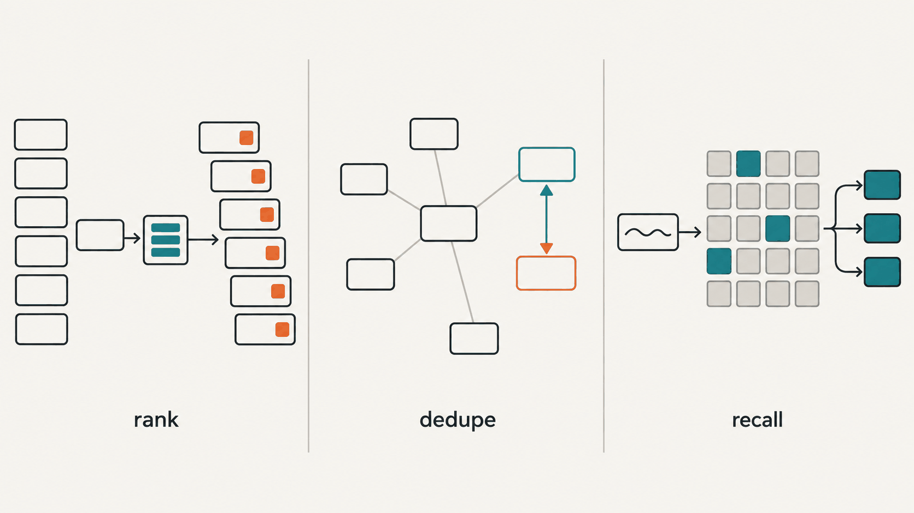
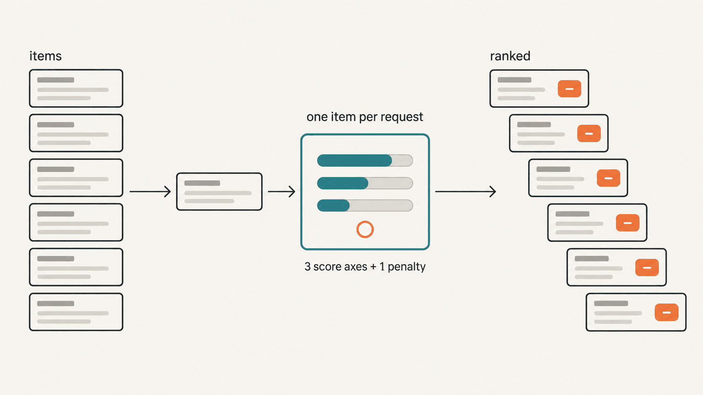

**English** | [한국어](README.ko.md)

# jev-judge-rank



**Rank a list on several written criteria, merge its near-duplicates, and recall the entries that matter for one sentence, using Jev (TypeSafe System One).**

Jev is a judgment model, and it cannot write text. It answers three kinds of question about a JSON state: Choice (pick one option), Score (a level on a scale you describe in words) and Noul (the probability that a statement is true). The answers are probabilities and a confidence value, not prose. A request takes about half a second or less (median 0.29 s in the example run below), and input costs $0.042 per million tokens; output is free. That makes it cheap to ask the same narrow questions about every item of a long list, a job that a single "pick the best ones" LLM prompt does with vague reasons and results that are hard to reproduce. This repository has three scripts:

- `scripts/jev_rank.py` judges every item on several axes and sorts by a weighted combined score.
- `scripts/jev_dedupe.py` finds near-duplicates and groups them under one representative item.
- `scripts/jev_recall.py` takes one sentence describing a situation and returns the corpus entries that would help with it.

Python 3.9 or newer, standard library only. Every request and response is kept in a local log (`raw_jev.jsonl`).

This is the start of the report from the recorded example run (40 synthetic idea cards, 80 requests):

```
Jev rank (2026-10-07)

...
Scale: items 40 · judged 40 · missing 0 · Jev calls 80 · input 42,526 tokens ≈ $0.002
Checks: feasibility vs has_demo rank correlation 0.265 (n=40)
...
==============================================================================
Part 1. Top 10 overall
==============================================================================

#1 [I36] Code Change Risk Triage   strengths [usefulness·feasibility]
  scores: novelty 1.73/4 · usefulness 2.97/4 · feasibility 3.62/4 · combined 0.67 · pitch_mechanism 0.88
  pitch: Sorts incoming pull requests by how risky they are so the riskiest get reviewed first.

#2 [I32] Dataset License Checker
  scores: novelty 1.90/4 · usefulness 2.70/4 · feasibility 3.25/4 · combined 0.637 · pitch_mechanism 0.6
  pitch: Checks whether a dataset's license allows the use you plan before you download it.

#3 [I12] Pull Request Risk Labeler   strengths [usefulness]
  scores: novelty 1.68/4 · usefulness 2.98/4 · feasibility 3.15/4 · combined 0.636 · pitch_mechanism 0.75
  pitch: Labels each pull request low, medium or high risk so reviewers know where to look first.
```

The full files are in `examples/ideas/out/`. At the other end of the list, the six vague ideas ("An AI assistant that makes your workday easier.") got novelty scores of 0.00 to 0.07 and probabilities of 0.06 to 0.13 that their pitch states a mechanism, and they rank 35 to 40.

## Five rules this follows, and the numbers behind them

1. **One item per request.** Ten Korean comments were put into one request and asked about by index: 8 of 10 answers were right. The two wrong ones, asked alone, were both right (confidence 0.92 and 0.99). It is a small sample, but the extra cost of asking separately is negligible, so every script sends one item (or one pair) per request. Questions are different: several questions about the same state go into one request, are answered in parallel, and add almost no time.
2. **Ask about a pair in both orders.** In a public Korean benchmark (mahlernim/jev-korean-benchmark), swapping the order of the inputs changed 13% of answers, while sending the identical request again changed 1 to 2%. `jev_dedupe.py` asks every pair as (a, b) and (b, a) and averages the two. In the example run below, the two orders of one pair differed by 0.11 (0.95 and 0.84).
3. **Attach duplicates to a representative, not union-find.** Union-find merges A and C whenever A~B and B~C, even when A and C are different things; in practice a transitive merge attached a security benchmark to the group of an unrelated project. Here each item is compared only with the representatives chosen so far. On 3,280 pairs from 254 project cards, true duplicates mostly scored 0.65 to 0.77 and no pair reached 0.85, which is where the default threshold of 0.65 comes from.
4. **Do not ask Jev about facts that are not in the state.** Asked whether each card was based on its project's README, without the README in the state, 65% of the answers landed between 0.3 and 0.7 (meaning "don't know"), and that penalty moved 8 places in a top 100. Given file names and paths instead of the document text, 47 of 50 answers landed between 0.3 and 0.85. Facts such as "has a demo" belong in an item field, and `jev_rank.py` turns them into a deterministic `field_penalties` entry.
5. **Do not use a wide Choice to select.** In a replay of 119 votes from a social-deduction game (the votes of one team), a single Choice over all players scored 33 to 38%, below the 51% of a random pick; narrow Noul questions per candidate, added up by code with a threshold, scored 71 to 79%. "Wide" means 11 or more options. With seven or fewer, a Choice asked in both orders did better than one Noul per option in a small test (5 of 8 against 3 of 8). For a ranking, ask a Score per item and let code sort.

A Noul answer of 0.5 means "don't know", not "medium"; to measure a degree, use a Score. A Score answer is the expected level index, 0 to 4 for five levels (not 1 to 5); `jev_rank.py` divides by the top index.

## Install

Python 3.9 or newer. Standard library only; there is nothing to `pip install`.

1. Clone this repository: `git clone https://github.com/tsetse012/jev-judge-rank`. To also use it as a Claude Code skill, put the folder at `~/.claude/skills/jev-judge-rank`; the scripts live under `scripts/`, so the folder works there as it is.
2. Create an API key at https://console.typesafe.ai/settings/keys and export it:

```bash
export TYPESAFE_API_KEY=...
```

The scripts read the key from this environment variable and from nowhere else. `--help` and `jev_dedupe.py --dry` work without it.

## Quickstart

Run from the repository root. These commands write to `./out/`, which git ignores. `examples/*/out/` holds the outputs of the run recorded for this README (2026-10-07; `jev-latest` answered as `jev-1.13.0`), made by the same commands with `--out` pointing into `examples/`: `rank.json`, `report.txt`, `groups.json`, `pairs.json`, `recall.json` and the `costs.json` ledgers. The raw request logs and `judged.json` are not included.

### Rank



```bash
python3 scripts/jev_rank.py --items examples/ideas/items.json --config examples/ideas/axes.json \
  --out out/rank --check feasibility:has_demo
```

`examples/ideas/items.json` holds 40 synthetic idea cards (`id`, `name`, `pitch`, `mechanism`, `has_demo`). `examples/ideas/axes.json` sends two requests per item: one with the three Score axes (novelty, usefulness, feasibility with weights 1, 1 and 0.7), and one with only the pitch in the state for the penalty Noul "the pitch states a concrete mechanism". `has_demo` is never sent; it becomes a field penalty of 0.05. Recorded run: 80 requests, 42,526 input tokens, $0.0018, exit status 0.

- Rank ran on all 40 items here, so #1 (I36) and #3 (I12) are the same idea in different words. On a real list, run dedupe first and rank the representatives.
- `--check feasibility:has_demo` prints the Spearman rank correlation between an axis and a numeric field: 0.265 (n = 40), weak agreement in the expected direction. It is a direction check, not a measure of accuracy. Read a value below 0.4 as a warning only when both sides measure the same thing.
- On a new config, run a smoke test first: add `--limit 10`, look at the spread of each axis, and reword the levels if every item lands on the same one. Then run again without `--limit` into the same `--out`; the judged items are reused.

### Dedupe


```bash
python3 scripts/jev_dedupe.py --items examples/ideas/items.json --text-fields pitch,mechanism \
  --order-field has_demo --out out/dedupe
```

TF-IDF kept 8 candidate pairs out of the 780 possible pairs, and each was asked twice: 16 requests, $0.0003. All 5 planted duplicate pairs averaged 0.895 to 0.975 and were merged; the other 3 candidate pairs averaged 0.03 to 0.055. The planted duplicates are close rewordings, so they score higher than duplicates in real lists usually do (0.65 to 0.77, rule 3). Result: 35 representatives, 5 merged items, in `examples/ideas/out/dedupe/groups.json`.

Add `--dry` to count the candidate pairs without a key or any request. Other options: `--against old.json` also compares every item with an older list and reports matches in `dup_against`; `--component-field` and `--component-values` switch pairs that include a component (an SDK, an MCP server, a plugin, a list) to a stricter question, because the default question ("true if only the language differs") merged a Go SDK with an MCP server; `--sim-fields` adds fields to the neighbour search without sending them to Jev. Run `python3 scripts/jev_dedupe.py --help` for the rest.

### Recall


```bash
python3 scripts/jev_recall.py --corpus examples/recall/corpus.json \
  --query "a Stop hook that checks whether the agent's done claim is backed by evidence" --out out/recall
```

The example corpus holds 35 one-line summaries of design patterns for Jev, catalogued from public Jev projects. They have kind `family`, so all 35 are judged: 35 requests, $0.0006. Four passed the 0.5 threshold:

```
0.76 [F02] Completion-claim check at stop -> stingray
0.62 [F27] Supervisor alongside a coding agent -> hermes-jev
0.62 [F17] Extraction by pointing at numbered fragments -> jeveryword
0.54 [F08] Memory selection, recall and validation -> jevmory
```

Write the query as the decision to be made: what gets sorted into what. If nothing passes, rewrite the query or lower `--threshold`.

## axes.json reference

Top level:

| key | type | default | meaning |
|---|---|---|---|
| `requests` | list | required | the requests sent for every item (see below) |
| `id_field` | string | `"id"` | unique id of an item |
| `title_field` | string | `"name"` | title shown in the report |
| `state_fields` | list of strings | every field except the id | item fields sent to Jev; a request can set its own |
| `field_penalties` | list of objects | `[]` | `{"field": ..., "below": ..., "penalty": 0.10}`: subtract `penalty` when the numeric field is below `below`. An item where the field is missing or not a number gets no penalty |
| `tie_break_field` | string | none | numeric field; on equal combined scores the larger value ranks higher |
| `top` | integer | `100` | items listed in Part 1 of report.txt |
| `strength_quantile` | number | `0.85` | an axis is listed as a strength of an item when its score is at or above this quantile |
| `round_digits` | integer | `3` | rounding of the combined score |
| `report_fields` | list of strings | `[]` | item fields printed under each item in Part 1 |
| `group_by_field` | string | none | adds Part 3, the top items grouped by this field (list values allowed) |

Other keys are ignored; the example uses `_about` for a note.

Each entry of `requests`:

| key | type | default | meaning |
|---|---|---|---|
| `name` | string | required | label used in the log and the report |
| `questions` | object | required | question key -> question (see below); keys must be unique across requests |
| `state_fields` | list of strings | top-level `state_fields` | item fields for this request only |
| `context_file` | path | none | JSON sent with every item in this request; a relative path is relative to the config file |
| `context_fields` | list of strings | every field | keep only these fields of each context row |
| `context_ids` | list | every row | keep only the rows whose `context_id_field` value is listed |
| `context_id_field` | string | `"id"` | field used by `context_ids` |
| `item_key`, `context_key` | string | `"item"`, `"context"` | state keys when a context is attached: `{item_key: item, context_key: context}` |

Put a large context (for example, a list of your own projects) into its own request, with only the rows and columns that question needs. Unrelated material in the state lowers accuracy on the other questions.

Each question:

| key | type | default | meaning |
|---|---|---|---|
| `type` | string | required | `"score"`, `"noul"` or `"choice"` |
| `instructions` | string | required | the whole question; Jev reads nothing from the key. Point at state fields with backticks, as in `` `pitch` `` |
| `levels` | list of strings | required for score | two or more; write all five out, and spell out what the lowest level looks like (Jev reads literally and does not guess what you meant) |
| `criteria` | object | required for choice | option -> description; include an "other" option |
| `role` | string | `"axis"` | `axis` (score only): part of the combined score. `penalty` (noul or score): subtract `penalty` when the answer is below `below`. Any other value, such as `info`: recorded in rank.json only. Choice answers are always only recorded |
| `weight` | number | `1` | axis weight |
| `below` | number | `0.4` | penalty threshold |
| `penalty` | number | `0.10` | amount subtracted |

Combined score = Σ(weight × score / top level index) / Σ weight, minus Noul penalties, minus field penalties.

## Recall corpus format

A JSON array of objects:

| key | required | meaning |
|---|---|---|
| `id` | yes | unique id |
| `text` | yes | what is matched and judged; a few hundred characters works well, and the first 900 are sent |
| `title` | no | sent with the text and used by the similarity step |
| `kind` | no | entries of kind `family` skip the shortlist and are always judged; use it for a small set of pattern summaries. `--kinds` filters by kind |
| `pointer`, `url`, `family` | no | where to read more; shown in the output, never sent |

Other entries go through a TF-IDF shortlist (`--shortlist`, default 120) before Jev. Family hits are listed first (at most max(3, top / 3)), then the others (at most `--top`, default 12).

## Output files

| file | written by | contents |
|---|---|---|
| `rank.json` | rank | one row per judged item: answers (with `_conf` for Score confidence), `combined`, `rank`, `strengths`, `tie` |
| `report.txt` | rank | method, scale, checks, Part 1 top items, Part 2 top 15 per axis, Part 3 groups, missing items |
| `judged.json` | rank | cache of answers by item id |
| `meta.json` | rank | config fingerprint and the local paths of the config and items |
| `groups.json` | dedupe | `reps` (each with its `members` and their averaged answer), `dup_against`, `pairs_asked`, `pairs_missing`, `threshold` |
| `pairs.json` | dedupe | cache of averaged answers by pair |
| `recall.json` | recall | query, corpus path, candidate and judged counts, threshold, hits |
| `raw_jev.jsonl` | all | every successful request and response, one JSON object per line, including the `model` that answered |
| `costs.json` | all | calls, input tokens and USD for the output folder, added up across runs |

**Resume.** Run the same command with the same `--out`. Rank skips items already in `judged.json`, and dedupe skips pairs already in `pairs.json`. Recall keeps no cache.

**Config changes.** Rank stores a fingerprint of `requests` (question text, levels, weights, roles, penalties), `state_fields` and the context. If it changed, the run stops so that old and new answers do not mix; pass `--reset` to clear `judged.json`, or use a new `--out` to keep both. `field_penalties`, `top`, `tie_break_field`, `strength_quantile`, `round_digits`, `report_fields` and `group_by_field` are not part of the fingerprint: change them and run again to rebuild `rank.json` and `report.txt` from the cache with no new requests. The cache is keyed by item id, so after editing an item's text, delete `judged.json` or use a new `--out`.

**Stopping.** Create the file `<out>/STOP` to stop a run: queued items are cancelled and finished ones are saved. Delete the file and run the same command to continue. An HTTP 402 answer (no credit left in the TypeSafe organization) stops the run the same way, with a message pointing to the billing page.

**Failures.** On HTTP 408, 429 and 5xx answers and on network errors a request is tried up to five times. An item or pair that still fails is printed, listed at the end of `report.txt` (rank), and makes the exit status 2. Run the same command again to retry only those.

**Cost.** `costs.json` multiplies input tokens by $0.042 per million (TypeSafe price list, 2026-09). All the example runs in this README together cost less than one cent.

## What it does not do

- It does not write text. There are no summaries or explanations beyond the fixed report. If you need prose, give the ranked list to an LLM.
- It takes no images, audio or video. Turn media into text first.
- Counting, arithmetic and date comparison belong in code; Jev does not do them reliably. Put such facts in item fields and use `field_penalties`.
- The thresholds (dedupe 0.65, recall 0.5, penalty 0.4) were measured on `jev-1.13.0`. The scripts ask for `jev-latest`; when that points to a new version, check the thresholds again on a sample of your own data. `raw_jev.jsonl` records which model answered each request.
- Answers are not exactly reproducible. In the two recall runs for this README, the 29 unchanged requests moved by 0.021 on average and by at most 0.06, so items near a cut-off can swap places. Read the ranking as an order, and read close neighbours as ties.
- The similarity step that picks candidate pairs and shortlists reads English words and Korean (Hangul syllables, split into overlapping two-character pieces, because Korean words carry particles and are often written without spaces). It does not split Japanese, Chinese, Cyrillic or other scripts. For such text, add an English description with `--sim-fields`, or use kind `family` in a small recall corpus. Jev itself reads those languages.
- A rank is a reading order, not a decision. Open the top items before you act on them.

## Privacy

Every request goes to TypeSafe's API at `api.typesafe.ai` (United States). What is sent:

- `jev_rank.py`: for each item, the fields in `state_fields` (every field except the id when `state_fields` is not set), the context rows you configured, and your question text.
- `jev_dedupe.py`: for each candidate pair, both items' title, first text field, and the other text fields (first 300 characters). `--sim-fields` stay local.
- `jev_recall.py`: the query sentence and, for each candidate, its kind, title and the first 900 characters of its text. `pointer`, `url` and `family` stay local.

The API key travels in the request header and is never written to disk. Nothing else leaves the machine: there is no telemetry and no other host. `raw_jev.jsonl` stays in the output folder and contains the same data you sent, so treat it like the input; `judged.json` and `pairs.json` hold only ids and answers. Remove secrets, personal data and anything you may not share with a third party from the fields you send, and check TypeSafe's terms for how requests are retained.

## Credits

- The recall question, one yes/no per item about whether it matters for the situation, is adapted from the pointer mode of [samdotmak/jev-recall](https://github.com/samdotmak/jev-recall) (MIT). jev-recall puts all memories into one request, each tagged with an id; `jev_recall.py` asks one candidate per request instead (rule 1).
- The 35 design patterns in `examples/recall/corpus.json` are our own one-line summaries of a catalogue of patterns collected from public Jev projects. `pointer` names one representative project for each pattern; the ids follow that catalogue, which has no F28 and keeps F99 for one-off designs.
- The order effect in rule 2 comes from the public benchmark mahlernim/jev-korean-benchmark.

## For Claude Code users

`SKILL.md` is a short manual for the agent. With this folder at `~/.claude/skills/jev-judge-rank`, Claude Code can run the three scripts when you ask it to rank, dedupe or recall with Jev. People only need this README.

## License

MIT
